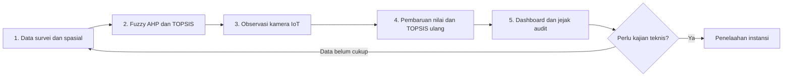

# Spesifikasi software berbasis bukti: DSS prioritas kajian JPO di Jatinangor

**Dokumen induk:** paper 7 halaman “Model Pendukung Keputusan untuk Memprioritaskan Lokasi Jembatan Penyeberangan Orang di Jatinangor”. Penamaan di bawah memisahkan **ketentuan naskah**, **keputusan desain**, dan **pekerjaan validasi yang belum terlaksana**.

## 1. Masalah dan batas keputusan

**Masalah yang dijawab (dari §I dan IV):** perencana memiliki beberapa kandidat lokasi penyeberangan dan sumber daya terbatas. Diperlukan proses yang konsisten, transparan, dan dapat diaudit untuk **memprioritaskan kajian lanjutan JPO**, dengan memperhatikan keselamatan, kebutuhan penyeberang, akses, kelayakan teknis dan biaya.

**Tidak termasuk dalam keluaran sah:** izin pembangunan, lokasi yang dinyatakan terbukti berbahaya tanpa data, pilihan otomatis “JPO lebih baik daripada zebra/pelican crossing”, rekomendasi penindakan, atau statistik kecelakaan/efektivitas kamera yang belum diukur.

### Alternatif awal

| ID | Sebutan Bagian IV.A | Catatan konsistensi |
|---|---|---|
| A1 | Area Unpad/BNI | Memerlukan konfirmasi titik spesifik |
| A2 | Simpang Ciseke/Sayang | Memerlukan konfirmasi titik spesifik |
| A3 | Area depan ITB Jatinangor | Memerlukan konfirmasi titik spesifik |
| A4 | GKPN/IPDN | Bagian V menyebut “Pertigaan Hegarmanah/IPDN”; **jangan satukan tanpa pembuktian** |

Lokasi dalam UI tidak memiliki nilai koordinat awal. Pengguna memasukkan koordinat dari sumber dengan metadata; plot posisi dibuat setelah nilai terkonfirmasi.

## 2. Tabel kriteria yang wajib identik dengan paper

| Kode | Subkriteria | Kelompok | Arah | Unit | Sumber yang relevan / prasyarat |
|---|---|---|---|---|---|
| C1.1 | Riwayat kecelakaan pedestrian | Keselamatan | Benefit | kejadian/tahun | Catatan resmi dengan cakupan spasial/periode |
| C1.2 | Kecepatan kendaraan | Keselamatan | Benefit | km/jam | Survei/perangkat terkalibrasi |
| C1.3 | Volume lalu lintas | Keselamatan | Benefit | kendaraan/jam | Hitungan periode setara |
| C1.4 | Kompleksitas penyeberangan | Keselamatan | Benefit | jumlah lajur | Audit jumlah lajur aktif |
| C2.1 | Volume penyeberang | Kebutuhan Pejalan Kaki | Benefit | orang/jam | Hitungan penyeberang |
| C2.2 | Intensitas jam sibuk | Kebutuhan Pejalan Kaki | Benefit | orang/15 menit | Puncak periode 15 menit |
| C3.1 | Jarak ke pusat aktivitas/fasilitas publik | Aksesibilitas | Cost | meter | Jarak jaringan/jalan kaki |
| C3.2 | Jarak ke halte/transportasi umum | Aksesibilitas | Cost | meter | Jarak berjalan |
| C4.1 | Ketersediaan ruang/lahan | Kelayakan Teknis | Benefit | m² | Luas efektif setelah verifikasi |
| C4.2 | Hambatan fisik/geometrik | Kelayakan Teknis | Cost | ordinal 1–5 | Rubrik audit belum diberikan paper |
| C4.3 | Kelayakan akses difabel | Kelayakan Teknis | Benefit | ordinal 1–5 | Rubrik audit belum diberikan paper |
| C5.1 | Estimasi biaya pembangunan | Ekonomi | Cost | Rupiah | Estimasi konstruksi |
| C5.2 | Kebutuhan lahan tambahan | Ekonomi | Cost | m² | Estimasi luas yang harus ditangani |
| C5.3 | Estimasi biaya pemeliharaan | Ekonomi | Cost | Rupiah/tahun | Estimasi operasi/pemeliharaan |

**Arah benefit dalam C1 dan C2 berarti makin tinggi skornya makin mendesak untuk dikaji; bukan berarti makin aman.** Nilai kosong (NULL) tidak boleh diganti 0 karena bisa mengubah peringkat secara salah.

## 3. Lima lapisan arsitektur (sesuai §IV.F)



**Mapping ke komponen perangkat lunak:**

- Modul data: registry lokasi, kriteria, observations, catatan sumber, pemeriksaan kualitas dan history.
- Modul keputusan: Fuzzy AHP hierarkis, checks konsistensi, bobot global, TOPSIS, perbandingan AHP, sensitivitas.
- Modul IoT: import data agregat per perangkat/periode, pemeriksaan sumber dan kalibrasi, pembaruan kriteria dinamis.
- Modul antarmuka: kandidat, peta **dari koordinat yang benar-benar diberikan**, tabel data, grafik/hasil peringkat, alasan preferensi dan jejak perubahan.

**Keputusan desain MVP:** aplikasi browser statis/offline memuat modul perhitungan dan formulir input observasi. Modul kamera fisik, basis data terpusat, pembatasan role, GIS basemap, API, dan analisis visi komputer belum tersedia. Pemisahan tersebut mencegah klaim implementasi IoT yang tidak pernah diuji.

## 4. Perhitungan

### 4.1 Fuzzy AHP

Hierarki 5 kelompok dengan jumlah subkriteria `[4,2,2,3,3]`. Satu matriks tingkat kelompok dan lima matriks lokal, semuanya per pakar. Setiap pakar menilai semua pasangan; nilai 1 berarti setara dan bukan default. Pada contoh implementasi, nilai 1–9 dipetakan ke TFN, kemudian matriks semua pakar diagregasi secara geometrik.

Bobot hasil pendekatan geometric mean Buckley dalam triad `l,m,u`, defuzzifikasi centroid, dan normalisasi menghasilkan bobot kelompok (`Wg`) dan bobot lokal (`Wlocal`). Bobot global kriterium `j`: `Wglobal_j = Wg_group(j) × Wlocal_j`, lalu normalisasi kembali untuk menjaga `sum(Wglobal)=1`.

Per-pakar, per-level konsistensi dihitung secara **diagnostik** dari matriks crisp modal menggunakan `CI=(λmax−n)/(n−1)` dan `CR=CI/RI`. Default perangkat lunak `CR≤0,1`; gagal → hitung ditolak. **Ini bukan definisi spesifik dalam paper** dan tidak membuktikan semua jenis konsistensi fuzzy. Seluruh konfigurasi harus disetujui dan dicatat.

**Rujukan metode eksternal:** Buckley DOI 10.1016/0165-0114(85)90090-9; skala TFN DOI 10.1155/2023/6692916; centroid DOI 10.3390/math11244984; CR DOI 10.3390/su14127437.

### 4.2 TOPSIS

Dari matriks keputusan `X[4][14]` dan bobot global yang lolos:

`r_ij = x_ij / sqrt(sum_i x_ij²)`

`v_ij = w_j × r_ij`

`A_j+ = max(v_ij)` bila benefit, `min(v_ij)` bila cost; `A_j−` sebaliknya.

`D_i± = sqrt(sum_j (v_ij − A_j±)²)`

`C_i* = D_i− / (D_i+ + D_i−)`

Kandidat diperingkat menurut `C*` menurun; kesamaan skor dilabel peringkat sama. Keluaran wajib disertai nilai `D+`, `D−`, bobot, arah kriteria, dan status kelayakan teknis awal. Perubahan himpunan kandidat dapat mengubah nilai ideal dan rank. Kolom yang seluruh nilainya nol tidak membedakan alternatif, dan harus dicatat sebagai kolom noninformatif.

**Pemeriksaan non-kompensatori:** belum ada threshold geometrik, lebar lahan minimum atau rule rekayasa yang diterbitkan dalam paper. Karena itu software **tidak mengarang ambang**. Status penapisan teknis ditampilkan dan hasil TOPSIS tetap diberi label prioritas *kajian*, tidak bisa dikonversi menjadi status "pasti dibangun".

### 4.3 IoT

**Urutan waktu dari paper:** input historis/survei → prioritas awal → observasi pada kandidat berperingkat tinggi (dan pembanding bila memungkinkan) → validasi → perubahan data dinamis → TOPSIS ulang.

Dari jumlah agregat yang telah diperiksa dalam interval `Δt` menit (minimal 15 menit untuk hitungan puncak):

- C1.3: `jumlah_kendaraan × 60 / Δt` (`kendaraan/jam`).
- C2.1: `jumlah_penyeberang × 60 / Δt` (`orang/jam`).
- C2.2: `jumlah_penyeberang terbanyak di salah satu interval 15 menit` (`orang/15 menit`).
- C1.2: kecepatan km/jam **hanya jika** kamera dan skala geometris dikalibrasi dan diuji.

Kandidat dan jendela waktu harus ditautkan. Jika hanya sebagian kandidat diobservasi, peringkat ulang tetap bisa dihitung secara matematis tetapi **harus diberi status validasi parsial**, bukan terbukti stabil secara empiris. Data yang sudah dibekukan sebagai baseline tidak boleh ditimpa diam-diam.

## 5. Kontrak data untuk versi produksi (proposal engineering, bukan hasil penelitian)

Entitas inti:

```
Candidate {id, title_in_paper, confirmed_name, lat?, lon?, evidence_ref?, technical_review_state}
Criterion {code, group_code, direction, unit, definition, version}
Measurement {candidate_id, criterion_code, numeric_value?, data_status, source_ref, observed_at, reviewer, version}
Expert {expert_id, name_or_pseudonym, affiliation?, role}
Comparison {expert_id, level_id, i, j, scale_mode, method_version, entered_at}
WeightRun {run_id, method_version, experts[], matrices[], diagnostics[], global_weights[], timestamp}
RankingRun {run_id, candidate_set[], matrix_version, weight_run_id, ideal_positive[], ideal_negative[], scores[], ranks[], warnings[], timestamp}
CameraObservation {candidate_id, device_id, session_start, session_end, duration_min, vehicle_count, crossings_count, peak_crossings_15min, speed_kmh?, speed_calibrated, quality_state, reviewer, source_ref}
ValidationRun {baseline_rank_run_id, observations[], updated_rank_run_id, changed_criteria[], rank_delta[], limitations[]}
```

Representasikan `missing`, `not_applicable`, dan `verified_zero` secara berbeda. Simpan satuan dan periode, aturan transformasi, sumber dan timestamp. Jangan menyimpan identitas pedestrian di database analisis jika tidak diperlukan.

Peran kerja versi produksi (usulan): penginput data, penelaah data lapangan, pakar pemberi penilaian, pengelola proyek, dan peninjau/auditor. Keputusan perizinan/pembangunan tetap **di luar** mesin DSS.

Endpoint (rencana, belum dikembangkan):

```
POST /api/projects/{project_id}/measurements
POST /api/projects/{project_id}/expert-comparisons
POST /api/projects/{project_id}/weight-runs
POST /api/projects/{project_id}/ranking-runs
POST /api/projects/{project_id}/iot-observations
POST /api/projects/{project_id}/validation-runs
GET  /api/projects/{project_id}/audit
```

Pilihan stack database/API/perangkat keras tidak ditentukan oleh paper. Rekomendasi engineering awal, bila nanti diperlukan, ialah Postgres dengan PostGIS untuk data spasial, API yang divalidasi skema, pemrosesan model visi komputer di edge, dan dashboard web. Ini **proposal teknologi**, bukan teknologi yang sudah dipakai dalam penelitian.

## 6. Keamanan dan QA sebelum uji nyata

- Verifikasi hak akses/izin pemasangan kamera, batas tampilan rekaman, dan retensi data oleh penanggung jawab lokasi.
- Kalibrasi penghitungan kendaraan dan pejalan kaki dengan hitungan manual *ground truth*, pada jam dan kondisi berbeda. Tetapkan metrik error, rentang kepercayaan, serta standar kelulusan dari hasil percobaan; paper belum menetapkan angkanya.
- Untuk speed/conflict detection, uji kamera terhadap kalibrasi dan pelabelan acuan; jangan hidupkan bila hasil belum layak.
- Audit sumber dan keutuhan data sebelum menjalankan ranking, termasuk pelacakan versi rubrik C4.2/C4.3.
- Uji ketergantungan bobot, penambahan/penghapusan alternatif, rank reversal, dan perubahan periode observasi.
- Bila deployment multiuser dilakukan, perlu autentikasi, otorisasi per peran, enkripsi transportasi, pelacakan perubahan immutable, serta backup. Prototipe offline belum menyediakan itu.

## 7. Acceptance criteria yang dapat diuji

| ID | Kondisi | Perilaku yang diharapkan |
|---|---|---|
| T01 | 56 nilai awal kosong | Peringkat tidak muncul |
| T02 | Satu nilai kosong | Tidak diubah ke 0; ranking tetap terkunci |
| T03 | C4.2/C4.3 di luar integer 1–5 | Pemeriksaan input ditolak |
| T04 | Sumber nilai kosong / identitas titik kandidat tidak terkonfirmasi | Ranking tidak boleh diajukan sebagai baseline |
| T05 | Perbandingan pakar tidak lengkap | FAHP tidak dihitung |
| T06 | CR > 0.10 menurut diagnostik implementasi | Bobot ditolak sampai penilaian ditinjau |
| T07 | Perbandingan sama penting semuanya pada test sintetik | Bobot kelompok 1/5, bobot lokal = 1/jumlah subkriteria, total global = 1 |
| T08 | TOPSIS benefit naik dan cost turun | Skor preferensi harus merefleksikan arah yang tepat |
| T09 | Seluruh alternatif sama | TOPSIS tidak memaksakan ranking palsu |
| T10 | IoT aktual belum ada | Tidak muncul hitungan kamera otomatis |
| T11 | IoT C1.2 tidak terkalibrasi | Tidak memperbarui kecepatan |
| T12 | Periode antar-kandidat berlainan | Penggabungan sesi observasi ditolak |
| T13 | IoT diamati pada sebagian kandidat | Hasil peringkat ulang diberi catatan validasi parsial |
| T14 | Pengguna mengimpor JSON | Bobot/ranking dari file tidak dipercaya; dihitung ulang |
| T15 | A4 belum dipastikan nama dan sumbernya | Tidak memperoleh status lokasi terkonfirmasi |

## 8. Roadmap bertahap yang tidak mengklaim hasil di luar bukti

**Tahap A — prototype analitis (file ini):** UI, data model, pembobotan, TOPSIS, skenario sensitivitas, audit input browser, formulir agregat IoT; test lokal. Selesai dalam batas status prototipe.

**Tahap B — verifikasi lapangan:** identitas A4, koordinat kandidat, sumber/satuan 56 indikator, rubrik ordinal, panel pakar, kalibrasi, validasi jenis fasilitas, persetujuan prosedur Fuzzy AHP. **Belum dilakukan.**

**Tahap C — integrasi kamera:** tentukan perangkat/sumber video yang legal, pipeline penghitungan agregat, pengujian error dan validasi periode, sinkronisasi timestamp, deteksi anomali. **Belum dilakukan.**

**Tahap D — produk penelitian siap uji bersama instansi:** database terpusat, audit trail, GIS basemap, API, persetujuan akses/privasi, laporan sensitivitas, validasi lapangan dan dokumentasi sign-off. **Belum dilakukan.**

## 9. Matriks keterlacakan paper → software

| Bukti dalam paper | Implementasi / pembatasan |
|---|---|
| §I.C, hal. 2: empat alternatif hanya kandidat awal | Label prioritas kajian; tidak mengklaim kebutuhan JPO |
| §II, hal. 2–3: Scoping Review/PRISMA-ScR | Dipakai sebagai justifikasi desain, tidak sebagai modul ranking tambahan |
| §III.B, hal. 3: input DSS dan pola ranking | Entitas data dan modul decision engine |
| §III.C, hal. 3: lima kelompok | Kelompok UI & hierarki Fuzzy AHP |
| §IV.A, hal. 5: A1–A4 | Registry kandidat; A4 ditandai tidak konsisten |
| §IV.B, Tabel II, hal. 6: 14 indikator/arah/unit | Data dictionary; 4×14 matriks nilai |
| §IV.C, hal. 5: Fuzzy AHP, TOPSIS & rumus (1)–(3) | Engine FAHP dan TOPSIS + audit perhitungan |
| §IV.D, hal. 6: AHP comparator, sensitivitas, kajian teknis | AHP kontrol, bobot skenario, status screening |
| §IV.E, hal. 6–7: kamera setelah ranking, periode setara | Form agregat setelah baseline, quality gates, rangking ulang |
| §IV.F, hal. 7: 5 lapisan + dashboard peta | Modul 5 tahap, plot koordinat setelah input tervalidasi |
| §V, hal. 7: roadmap aplikasi web 4 komponen | Source code offline prototype & tahapan produksi |

---
**Penilaian akhir:** prototipe mengimplementasikan bagian algoritmik yang mungkin diuji secara offline dan secara jelas menahan fitur yang memerlukan data/alat/keputusan peneliti. Tidak ada bobot, data sensor, koordinat, skor keselamatan, atau peringkat Jatinangor yang dikarang.

## 10. Verifikasi implementasi yang dilakukan

- Aplikasi self-contained dan sumber modular disinkronkan melalui `build_offline.py`; tidak mengambil library atau data dari CDN.
- Pengujian engine memastikan konsistensi skala Saaty/TFN, bobot dan CR, arah benefit/cost, kondisi matriks degenerate, serta sensitivitas.
- Browser E2E menggunakan data uji sintetis yang **tidak pernah dimuat sebagai data awal**. Pengujian mencakup baseline TOPSIS, perubahan berdasarkan agregat IoT, ekspor CSV dan JSON serta import revalidasi.
- Audit responsif dijalankan pada 390, 768, dan 1440 piksel pada semua tujuh halaman tanpa overflow dokumen.
- Tidak ada peta atau angka keselamatan dikonstruksi dari perkiraan; status A4 dan rubrik ordinal tetap menjadi catatan verifikasi.